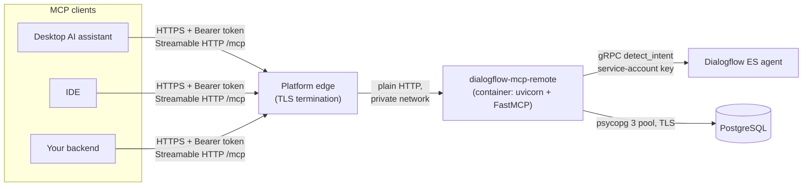
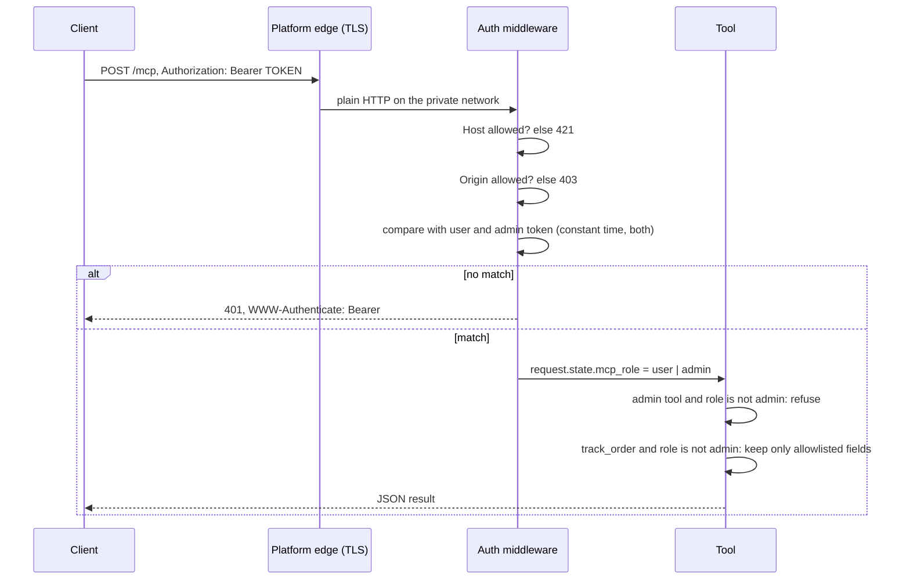
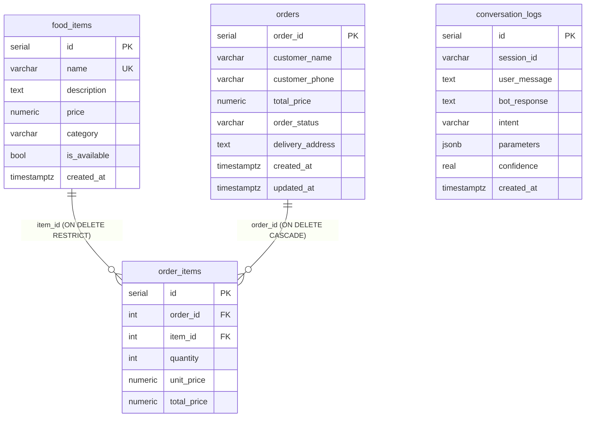
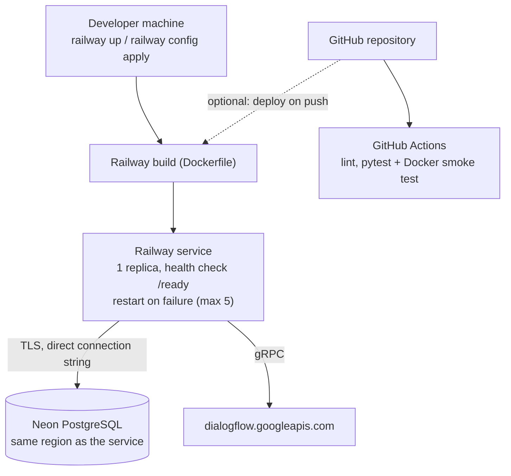

# Architecture

This document describes how `dialogflow-mcp-server` is built, as the code is today. Design decisions are recorded in [the ADR index](adr/README.md); the one that is proposed but not built (session binding, ADR 0007) is called out where it matters.

## 1. What the system is

An MCP server that exposes a **Dialogflow ES** food-ordering agent and a **PostgreSQL** order database as MCP tools. Any MCP client can call them: a desktop AI assistant, an IDE, or your own backend.

- **Dialogflow ES** does the language understanding. It finds the intent and extracts dish names and quantities.
- **PostgreSQL** holds the menu and the orders. It enforces the business rules with constraints and transactions.
- **MCP** is the single contract between the two and the AI clients. There is no bespoke REST API and no Dialogflow webhook.

The package ships three entry points:

| Console script | Module | Transport | Purpose |
|---|---|---|---|
| `dialogflow-mcp` | `dialogflow_mcp.server` | stdio | A thin Dialogflow **CX** server with one tool (`detect_intent`). No database. Needs the optional `cx` extra. |
| `dialogflow-mcp-es` | `dialogflow_mcp.server_es` | stdio | The Dialogflow **ES** food-ordering server with all tools. For local and desktop use. |
| `dialogflow-mcp-remote` | `dialogflow_mcp.remote_server` | HTTP | The ES server over Streamable HTTP (default) or SSE, with Bearer auth. |

The rest of this document covers the ES server and its remote mode.

## 2. System context

A local client can also start `dialogflow-mcp-es` as a subprocess and talk to it over stdio. In that case there is no HTTP layer, no token and no edge.

## 3. Components

| Component | Technology | Where | Responsibility |
|---|---|---|---|
| Remote server | Python, FastMCP (`mcp>=1.30,<2`), Starlette, uvicorn | [`remote_server.py`](../src/dialogflow_mcp/remote_server.py) | Builds the HTTP app. Streamable HTTP at `/mcp`, or SSE at `/sse` and `/messages/` with `MCP_TRANSPORT=sse`. Adds `/health`, `/ready` and the auth middleware. Validates configuration at startup (tokens, `DATABASE_URL`, Google key, admin settings), switches the admin check to fail-closed and installs a plain one-line log handler. |
| Tool server | FastMCP | [`server_es.py`](../src/dialogflow_mcp/server_es.py) | Defines the tools, the `admin_tool` decorator and admin check, the database error handling and the Dialogflow client. Runs over stdio on its own. |
| CX server | FastMCP | [`server.py`](../src/dialogflow_mcp/server.py) | A separate `detect_intent` tool for a Dialogflow CX agent. |
| Auth middleware | Pure ASGI, `hmac.compare_digest` | `BearerAuthASGIMiddleware` in `remote_server.py` | Checks Host and Origin, then the Bearer token. Marks each request with role `user` or `admin`. |
| NLU client | `google-cloud-dialogflow` v2 | `server_es.py` | One cached `SessionsClient`. Uses a regional endpoint when `DF_LOCATION` is not `global`. |
| Persistence | psycopg 3, psycopg_pool | [`database.py`](../src/dialogflow_mcp/database.py), [`db/init.sql`](../db/init.sql), [`db/seed_demo.sql`](../db/seed_demo.sql) | Connection pool and query helpers. `transaction()` runs several statements on one connection in one transaction. |
| Google credentials | `google-auth` | [`gcp_auth.py`](../src/dialogflow_mcp/gcp_auth.py) | Reads the service-account key content from `GOOGLE_APPLICATION_CREDENTIALS_JSON`, or falls back to Application Default Credentials. |
| Agent definition | Dialogflow agent export (JSON) | [`dialogflow/agent/`](../dialogflow/agent/), [`scripts/dialogflow_agent.py`](../scripts/dialogflow_agent.py) | Intents and entities under version control. The script exports and restores the agent through the API. |
| Container | `python:3.14-slim`, uv, multi-stage, non-root user | [`Dockerfile`](../Dockerfile) | Reproducible image for the remote server. |
| Hosting config | Railway infrastructure as code | [`.railway/railway.ts`](../.railway/railway.ts) | Example deployment: Dockerfile build, `/ready` health check, restart on failure. |
| CI | GitHub Actions | [`.github/workflows/ci.yml`](../.github/workflows/ci.yml) | ruff, mypy, the golden-set overlap check, pytest with a required Postgres service container, a package build, and a Docker build and smoke test. Actions are pinned to commit SHAs. |
| NLU evals | Python CLI | [`evals/`](../evals/README.md) | Measures intent and slot accuracy of the Dialogflow agent against a dev set and a held-out set. |

## 4. MCP tool surface

| Tool | Role | Reads / writes | Notes |
|---|---|---|---|
| `detect_intent(text, session_id?, language_code="en")` | user | Dialogflow; **writes** `conversation_logs` | `text` is 1-256 characters. `session_id` is 1-36 of `[A-Za-z0-9_-]`; a UUID is generated if omitted. The log insert runs after the Dialogflow call; a database failure is logged and does not fail the call. Upstream errors return a generic message and the error type, not Google's error text. |
| `get_menu(category?)` | user | reads `food_items` | Available items only. The category filter escapes LIKE wildcards. |
| `get_food_item_details(food_name)` | user | reads `food_items` | Exact case-insensitive match first, then a substring match accepted only if unique. If ambiguous, lists up to 10 candidates. |
| `track_order(order_id)` | user | reads `orders`, `order_items` | Unless the caller may use admin tools, returns only the allowlisted order fields `order_id`, `total_price`, `order_status`, `created_at`, `updated_at` (see section 5). |
| `complete_order(customer_name, customer_phone, items, delivery_address="Counter Collection")` | user | **writes** `orders`, `order_items` in one transaction | `items` is a list of `{name, quantity}`. Quantity is a whole number 1-50 per item. At most 50 entries and 20 distinct items. Repeated names are merged. Field lengths are checked against the column widths. Prices and totals are computed on the server. |
| `update_order_status(order_id, new_status)` | admin | writes `orders` | Sets any of `in progress`, `preparing`, `out for delivery`, `delivered`, `cancelled`, in any order; transitions are not enforced. The database `CHECK` constraint enforces the same set. |
| `get_recent_orders(limit=10, status?)` | admin | reads `orders` | `limit` is clamped to 1-100. Returns customer name and phone. |
| `get_conversation_logs(session_id?, limit=20)` | admin | reads `conversation_logs` | `limit` is clamped to 1-100. |

Order IDs are checked against the Postgres `INTEGER` range before any query, so out-of-range values return a clean "not found" error. Every database tool runs its blocking body through `_run_db`: any `psycopg.Error` (including a pool timeout) becomes `{"error": "Database temporarily unavailable. Please try again."}`, and the server logs `database_error tool=<name> error=<class> sqlstate=<code>`, never the driver's message.

### When admin tools exist

The three admin tools are defined with the `admin_tool` decorator, which wraps them with the role check and registers them only when `MCP_ADMIN_TOOLS` is truthy (`1`, `true`, `yes`, `on`) at the time `server_es` is imported. A blank value counts as unset.

| Mode | Default | Who may run admin tools |
|---|---|---|
| stdio (`dialogflow-mcp-es`) | `MCP_ADMIN_TOOLS` defaults to `on` | The local user. There is no request context, so the admin check allows the call, and `track_order` returns customer details. |
| remote, `MCP_ADMIN_TOKEN` set | Admin tools are forced on | Only requests carrying the admin token. User-token requests see the tools in `tools/list` but are refused when they call them ([ADR 0004](adr/0004-unfiltered-tools-list.md)). |
| remote, no `MCP_ADMIN_TOKEN` | `MCP_ADMIN_TOOLS` defaults to `off` | Nobody, unless the operator sets `MCP_ADMIN_TOOLS=on`. Then the single shared token is treated as admin, and the startup banner warns about it. |

Setting `MCP_ADMIN_TOKEN` together with an explicitly falsy `MCP_ADMIN_TOOLS` is a startup error, and so is building a second app without an admin token in a process that already built one with it ([ADR 0005](adr/0005-admin-tools-env-precedence.md)).

## 5. Security model

### Tokens

- `MCP_AUTH_TOKEN` (user) is required. `MCP_ADMIN_TOKEN` (admin) is optional.
- Each must be at least 16 characters, and the two must differ. Otherwise the server refuses to start. Generate them with `python -c "import secrets; print(secrets.token_urlsafe(32))"`.
- The middleware compares the raw `Authorization` header bytes with `Bearer <token>` using `hmac.compare_digest`. It always compares against both tokens, so timing does not show which one matched ([ADR 0003](adr/0003-token-comparison.md)). The scheme is case-sensitive: `bearer` is rejected.
- Tokens are shared secrets, not per-person identities. There is no per-user audit trail.

### Roles

- The middleware writes the role into a fresh copy of the ASGI scope (`request.state.mcp_role`).
- Admin tools can only be registered through the `admin_tool` decorator. Its wrapper calls `_admin_denied()` on the event loop before any work, refuses a request whose role is not exactly `admin`, and logs one WARNING line `admin_tool_denied tool=<name> role=<role|none>`.
- If there is no request context, the answer depends on the mode. Over stdio (and in direct Python calls) the call is allowed: the local user is trusted. `create_remote_app()` switches the process to fail-closed, so in remote mode a call without a request is refused ([ADR 0001](adr/0001-fail-closed-admin-check.md)).
- A test pins the registered tools to two literal sets, public and admin, and checks that every admin tool refuses a user request before touching the database. A new tool in neither set fails CI.
- Admin tool names are visible to user-token clients in `tools/list`. Hiding names is not treated as a security control ([ADR 0004](adr/0004-unfiltered-tools-list.md)).
- MCP sessions are not bound to the token that opened them. The role is evaluated per HTTP request, so a user token cannot gain admin rights through an admin session. Binding sessions to credentials is proposed, not built ([ADR 0007](adr/0007-session-token-binding.md)).

### Host and Origin checks (DNS rebinding)

- The middleware runs the MCP SDK's own `TransportSecurityMiddleware` before it checks the token. A bad `Host` gets 421 and a bad `Origin` gets 403. The SDK's check also stays on inside the MCP app as a second layer.
- WebSocket connections are closed with code 1008 (no transport here uses them); unknown ASGI scope types never reach the app.
- The allowlists default to localhost (`127.0.0.1`, `localhost`, `[::1]`, any port). Add your public hostname with `MCP_ALLOWED_HOSTS` and browser origins with `MCP_ALLOWED_ORIGINS`. A bare host such as `your-service.up.railway.app` is also accepted with any explicit port.

### Customer data in `track_order`

Order IDs are sequential, so any user-token holder could enumerate orders. For a caller who may not use admin tools, `track_order` keeps only an allowlist of order fields (`order_id`, `total_price`, `order_status`, `created_at`, `updated_at`), so a column added to the query later stays hidden until someone adds it on purpose ([ADR 0002](adr/0002-pii-allowlist.md)). The decision is made on the event loop, where the request context is available, before the database work runs in a worker thread.

### Unauthenticated paths

Only `GET /health` and `GET /ready` skip auth and the Host check, so platform probes can reach them.

- `/health` is liveness. It returns `{"status": "healthy", ...}` and touches no dependency.
- `/ready` is readiness. It runs `SELECT 1` with a 5 second limit and checks that `GCP_PROJECT` and Google credentials are configured (`DATABASE_URL` is already required at startup). It returns 200 or 503 and reports only check names with `ok`, `fail` or `incomplete`, never values or error text.

### Secrets and transport

- Database credentials, the Google service-account key and the tokens stay on the server, in environment variables. Clients only hold a Bearer token.
- `GOOGLE_APPLICATION_CREDENTIALS_JSON` is validated at startup. A malformed key stops the server, and the error message never contains the key.
- `DATABASE_URL` is required by the remote server. Only the stdio servers fall back to the local docker compose database.
- TLS is terminated by the hosting platform. The container serves plain HTTP. Do not expose the container port directly to the internet: the token would travel in cleartext.
- The Google service account needs only the *Dialogflow API Client* role. Exporting and restoring the agent needs an admin identity, used from a developer machine, not by the server.

## 6. Data model

Schema and menu: [`db/init.sql`](../db/init.sql) (idempotent, safe to run more than once). Demo orders: [`db/seed_demo.sql`](../db/seed_demo.sql), loaded by docker compose and the tests, never needed in production. Existing databases created from an older schema are upgraded with [`db/migrations/`](../db/migrations/).

- **Constraints:** prices and totals are non-negative. Quantity is above 0. `order_status` must be one of the five allowed values. `(order_id, item_id)` is unique, so one order has one line per item. `order_items.order_id` and `item_id` are `NOT NULL`.
- **Indexes:** `lower(food_items.name)` for name lookups, `orders(order_status)`, `order_items(item_id)` for the foreign key, and `conversation_logs(session_id)`.
- **Trigger:** `trg_orders_updated_at` keeps `orders.updated_at` current.
- **Seed data:** `init.sql` adds the nine South African dishes. `seed_demo.sql` adds four demo orders (IDs 1001-1004) with obviously fictional customers ("Test Customer 1", "+27 00 000 0001", "1 Example Street, Testville") and resets the order sequence to continue after them.

`complete_order` resolves every item, inserts the order and inserts all lines in one transaction on one connection. Any failure rolls back the whole order.

## 7. Conversational layer

The Dialogflow ES agent is kept as code in [`dialogflow/agent/`](../dialogflow/agent/) (the JSON export format). [`scripts/dialogflow_agent.py`](../scripts/dialogflow_agent.py) exports the live agent into that folder and restores the folder into a project.

**Webhook fulfillment is off** for every intent. Replies are the agent's static response text. The MCP client reads the intent and parameters from `detect_intent` and calls the database tools itself.

| Intent | Input context | Output context | Parameters | Behaviour |
|---|---|---|---|---|
| `new.order` | none | `ongoing-order` | none | Starts an order and lists the menu. |
| `order.add` | `ongoing-order` | `ongoing-order` | `food_Item[]` (required), `number[]` | Confirms the added items. Prompts for a dish if none was found. |
| `order_remove` | `ongoing-order` | `ongoing-order` | `food_Item[]` | Confirms the removed items. |
| `order.complete` | `ongoing-order` | `ongoing-order` | none | Confirms. The client then calls `complete_order`. |
| `track.order` | none | `ongoing-tracking` | `number` (integer, required) | Asks for the order ID if it is missing. |
| `track.order - more` | `ongoing-tracking` | `ongoing-tracking` | `number` | Follow-up with an order ID. |
| `Default Welcome Intent` / `Default Fallback Intent` | none | none | none (Welcome has an optional `date-time`) | Greeting, and help text with the menu. |

- **`food_Item`** is a map entity with fuzzy matching. Its values are exactly the nine menu dishes, with local synonyms.
- **Quantities:** `number[]` can be shorter than `food_Item[]`. For example, "a kota" yields no number. Clients should default a missing quantity to 1 rather than pairing the two lists by position.
- Slot filling consumes the next turn. After "track my order" and the prompt for an ID, the reply "1003" is matched to `track.order`, not to `track.order - more`.

## 8. Concurrency model

FastMCP runs a plain `def` tool inline on the event loop. A blocking database query or gRPC call there would stall every other request, including `/health`.

- **Every tool is `async def`.** It validates on the event loop where needed (the admin check and the PII decision read the request context there), then runs its blocking body in a worker thread with `anyio.to_thread.run_sync`.
- **Cancellation:** if the client cancels, the cancellation takes effect after the worker thread finishes. A transaction is never left half done.
- **Database pool:** one process-wide `psycopg_pool.ConnectionPool`, created lazily under a lock. Defaults: `DB_POOL_MIN=0`, `DB_POOL_MAX=5`, `DB_POOL_TIMEOUT=10` seconds. Connections are checked before use (one extra round trip per checkout, so a connection dropped by Neon or a proxy is replaced instead of failing a query; `DB_POOL_CHECK=off` turns this off), closed after 240 s idle and recycled after 30 minutes. With all connections busy, a tool waits up to the pool timeout and then returns the generic database error. The pool size, not the thread count, bounds concurrent database work.
- **Dialogflow client:** one `SessionsClient`, created lazily under a lock and reused. gRPC clients are thread-safe. It is rebuilt only if the endpoint changes.
- **Readiness:** `/ready` runs its `SELECT 1` in a worker thread with a 5 second limit. On timeout it returns 503 at once and lets the thread finish on its own.

The server runs as one uvicorn process. MCP session state lives in that process, so scaling out needs sticky routing or a single replica.

## 9. Deployment topology (example)

The repository includes a working configuration for one low-cost setup. Any container host with TLS termination and any PostgreSQL will do.

- **Container:** multi-stage build with uv. The runtime image holds only Python and the virtual environment and runs as a non-root user. The image `HEALTHCHECK` uses `/health`. The command is `dialogflow-mcp-remote` on port 8000.
- **Railway:** [`.railway/railway.ts`](../.railway/railway.ts) defines the service. The platform health check uses `/ready` with a 60 second timeout, so a deploy that cannot reach the database or lacks configuration does not go live. Variables are not managed in that file; secrets are set in the Railway dashboard.
- **Neon:** managed PostgreSQL. Put the service and the database in the same region, since every tool call makes one or more SQL round trips.
- **Dialogflow ES:** the agent lives in your Google Cloud project (`GCP_PROJECT=your-gcp-project-id`).
- **Cost:** at demo traffic this fits the free or trial tiers of Railway, Neon and Dialogflow ES. Check each provider's current limits.

Required environment for the remote server:

| Variable | Purpose |
|---|---|
| `MCP_AUTH_TOKEN` | User token (required). |
| `MCP_ADMIN_TOKEN` | Admin token (optional). |
| `MCP_ALLOWED_HOSTS` | Public hostname, e.g. `your-service.up.railway.app`. |
| `DATABASE_URL` | PostgreSQL connection string (required; the server refuses to start without it). |
| `GCP_PROJECT` | Google Cloud project that holds the agent. |
| `GOOGLE_APPLICATION_CREDENTIALS_JSON` | Service-account key content (or `GOOGLE_APPLICATION_CREDENTIALS` with a path). |
| `MCP_TRANSPORT` | `streamable-http` (default) or `sse`. |
| `DF_LOCATION`, `DF_ENVIRONMENT` | Optional regional endpoint and published agent environment. |

## 10. Evaluation

[`evals/`](../evals/README.md) holds an NLU evaluation harness for the Dialogflow agent. It calls Dialogflow directly with `SessionsClient.detect_intent`. It does not go through the MCP server and writes nothing to the database.

- A dev set of 182 labelled single-turn utterances and 16 conversations covers all eight intents. A held-out set of 54 utterances and 5 conversations was written separately, from a brief without the training phrases or the dev set, and filtered so that nothing in it resembles a training phrase or a dev utterance ([`evals/leakage.py`](../evals/leakage.py)).
- The report gives intent accuracy, macro F1, per-intent precision and recall, a confusion matrix, slot accuracy, accuracy by phrasing tag and latency, and the headline metrics again without dev cases that are verbatim training phrases.
- Training-phrase fixes driven by the dev set raised its intent accuracy from **73.6% to 98.4%** (76.6% to 98.2% without the 11 verbatim cases). The same agent scores **87.0%** on the held-out set, which is the figure to expect on unseen phrasing. Part of the dev gain repaired a broken Welcome intent.
- The pre-fix agent is kept in [`evals/agents/baseline-2026-11-17/`](../evals/agents/baseline-2026-11-17/) so the baseline can be reproduced on a staging project.
- The harness can compare a run against a stored baseline and exit non-zero on a drop, so it can serve as a CI check for agent changes run against a staging copy of the agent.

## Decision records

See [adr/README.md](adr/README.md).
